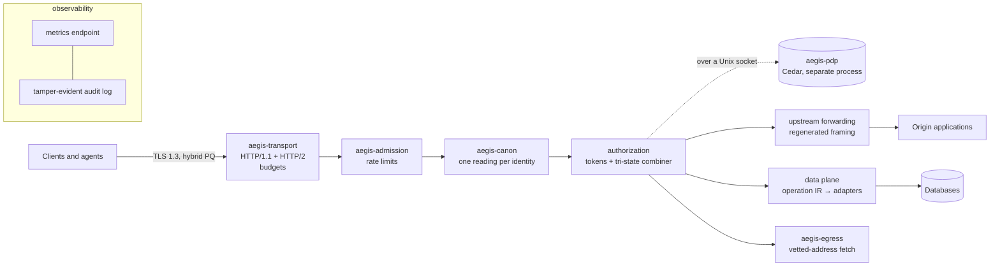

# AEGIS

A single-binary reverse proxy and agent gateway with post-quantum TLS, whose core security rules are written down as
machine-checked models and tested against the running code.

> [!IMPORTANT]
> **Pre-release research software. Do not use in production.** There is no release yet, no external audit, and no
> production deployment. Most of the code was written by AI agents working under the gates described below; no
> human has reviewed all of it. "AEGIS" is a working name.

## Why

The layer between clients and applications (reverse proxies, API gateways) is where request smuggling, path
confusion, cross-tenant data leaks, server-side request forgery and resource exhaustion usually happen. AI agents
make this worse: more automated clients, and faster discovery of every parsing disagreement.

AEGIS takes the approach of a **reference monitor**: every request and every extension call crosses one small
pipeline (admission → canonicalization → authorization → capability-scoped effect). Each rule on that path is stated
precisely, and each statement is either proved over a model or checked against the real binary by an independent
test oracle. Where a property is only tested, or only trusted, the documentation says so.

## What is different

| area | approach |
|---|---|
| **Post-quantum TLS** | TLS 1.3 only. Hybrid ML-KEM key exchange is preferred on public listeners and required on agent and API listeners, including SecP384r1MLKEM1024 (RFC 10024), interoperability-tested. |
| **One reading per request** | Exactly one parser for each identity (path, host, query, headers, cookies, JSON). Ambiguous input is rejected, never repaired, so AEGIS and the application behind it cannot disagree about what a request means. |
| **Fail-closed authorization** | Policy combination is tri-state: an error, timeout or crash means deny. Cedar policies run in a separate process. |
| **Tenant-safe data access** | Data operations go through an intermediate language whose translation to SQL is proved, over a model, to return exactly the permitted rows. |
| **Agent gateway** | Capability tokens that can only narrow when delegated, an MCP listener gate, and outbound fetches that cannot reach private or cloud-metadata addresses. |
| **Bounded resources** | Per-connection and per-identity budgets around the HTTP/2 stack and in admission; stalled streams are reaped. |
| **Evidence, not adjectives** | 80 Lean 4 theorems over hash-frozen statements; 44 test oracles, each shown to fail on deliberately broken input before it counts; Kani proofs on parts of the Rust code; byte-identical reproducible builds; a hash-chained journal for every gate run. |

## Quick start

Requirements: Linux x86_64 or aarch64, Rust 1.99.1 (picked automatically from `rust-toolchain.toml`), and `openssl`
to make a test certificate.

```sh
cargo build --release --locked -p aegis-bin
target/release/aegis                       # exits 78: no configuration, no listener (fail-closed boot)
target/release/aegis check-config config.json --print-effective
target/release/aegis --config config.json --cert tls.crt --key tls.key
```

A minimal `config.json` (schema: [`interfaces/F8-config.schema.json`](interfaces/F8-config.schema.json)):

```json
{"v": 1,
 "listeners": [{"name": "pub", "bind": "127.0.0.1:8443", "profile": "P-PUBLIC-WEB", "alpn": ["h2", "http/1.1"]}],
 "admin": {"bind": "127.0.0.1:9464"},
 "vhosts": [{"host": "example.test",
             "routes": [{"id": 1, "path": "/", "to": {"upstream": "127.0.0.1:8080"}, "authz": "allow-all"}]}]}
```

A route without an `authz` policy is denied.

## What is proven, tested and trusted

Each claim is labelled with how strong its evidence is:

- **R4**: a machine-checked proof about a model (not about the compiled Rust code);
- **R3**: enforced by Rust types or capabilities;
- **R2**: a differential oracle comparing the real code against a reference;
- **R1**: an executed test harness.

| property | evidence |
|---|---|
| Fail-closed policy combination | R4 + exhaustive test |
| Delegated capability tokens only narrow; the Rust verifier agrees with the Lean model | R4 model + R2 (10⁶ cases, 0 divergences) |
| Tenant-scoped reads return exactly the permitted rows | R4 model + R2 oracle |
| Writes never touch another tenant's rows (PostgreSQL, SQLite, MariaDB, CockroachDB, with the mandated forms) | R2 |
| One canonical reading per request identity | R2 (117,000+ cases, 0 disagreements) |
| Rate-limiter and token-bucket arithmetic | Kani proofs on the Rust code within stated bounds; the rest R1 |
| Stalled HTTP/2 streams are reaped; per-connection memory is bounded | R1, measured with h2load |
| Outbound requests never reach private or metadata addresses | R2 (273 cases, 0 violations) |

**Trusted, not verified.** hyper, h2, tokio, rustls, the AWS-LC C code and the Rust compiler are part of the trusted
base and are not verified by this project. Some AWS-LC parts (the ML-KEM and ML-DSA assembly, elliptic-curve
arithmetic) are formally verified by their own maintainers; that work is theirs, not ours.

**Not claimed:** side-channel isolation; the correctness of third-party extensions, adapters or applications; the
security of any path that bypasses AEGIS.

**FIPS 140-3.** AEGIS is not a validated cryptographic module and makes no FIPS validation claim. The `cmvp` build
profile uses only the AWS-LC FIPS 140-3 module (CMVP certificate #5314, the static module) and is built on Amazon
Linux 2023, that module's validated environment. The hybrid key exchange as a whole is not FIPS-approved.

The full list, with every caveat, is [`SECURITY_CLAIMS.md`](SECURITY_CLAIMS.md).

## Architecture



Crates are layered (types → pure logic → protocol shells → effects → assembly), and `cargo xtask layering` enforces
it. First-party crates are `#![forbid(unsafe_code)]`, except one isolation crate and the opt-in io_uring front, whose
`unsafe` sites are capped and audited.

## Status

Every development phase has passed its gate suite; each verdict is a committed, hash-chained journal.

| phase | scope | gate steps |
|---|---|---|
| 0 | repository, pins, frozen interfaces, verification wall | 25/25 |
| 1 | 21 design experiments, 10 design changes applied | closed |
| 2 | reverse proxy: transport, TLS, canonicalization, admission, config, audit, metrics, ACME, zero-downtime upgrade | 55/55 |
| 3 | agent gateway: capability tokens, Cedar decision process, SSRF-guarded egress, MCP gate | 61/61 |
| 4 | data plane and native handlers | 107/107 |
| 5 | process and Wasm isolation | 129/129 |
| 6 | compliance profiles (including the `cmvp` build) and release tooling | 157/157 |
| 7 | optional modules, each off by default: PROXY protocol, L4, io_uring, Merkle Tree Certificates, MariaDB and CockroachDB adapters, OTLP export | 191/191 |
| 8 | closing residual gaps and hardening | 215/215 |

Verdicts are in [`gates/`](gates/). Run a phase's whole suite with `python3 -I ci/run-gates.py --phase 8` (every gate
and its negative control; building the full wall also needs Python 3.12, Lean 4.35.0 and Docker). HTTP/3 and
WebTransport are deferred until their upstream libraries settle (re-check 2027-03-30).

Performance numbers so far are provisional (single runs, laptop, LAN and cloud VMs); they are recorded with their
conditions in [`SECURITY_CLAIMS.md`](SECURITY_CLAIMS.md).

## Documentation

| document | purpose |
|---|---|
| [`SECURITY_CLAIMS.md`](SECURITY_CLAIMS.md) | what is claimed, at which rung, and what is trusted but unproven |
| [`SECURITY_BY_DESIGN.md`](SECURITY_BY_DESIGN.md) | how finite code and proof extend to unbounded use; the plan to shrink the trusted base |
| [`research/ARCHITECTURE.md`](research/ARCHITECTURE.md) | reference architecture and decision record |
| [`spec/SPEC_INVARIANTS.md`](spec/SPEC_INVARIANTS.md) | frozen invariant statements |
| [`interfaces/`](interfaces/) | frozen interfaces F1–F13 and their hash manifest |
| [`oracles/README.md`](oracles/README.md) | the contract every test oracle follows |
| [`DEVIATIONS.md`](DEVIATIONS.md) | where the implementation departs from the architecture, and why |
| [`compliance/COMPLIANCE_MAP.md`](compliance/COMPLIANCE_MAP.md) | mapping to NIST 800-53, SSDF and the EU Cyber Resilience Act |

## How it was built

Development followed a role-separated workflow (specification author, implementer, verifier), described in
[`CLAUDE.md`](CLAUDE.md) and [`research/templates/IMPLEMENTATION_PLAN.md`](research/templates/IMPLEMENTATION_PLAN.md).
Most of the work was done by AI agents. A change was accepted only when an independent oracle passed and that
oracle's negative control failed; checks were never weakened to make a change pass. Where a goal could not be met,
the repository records why (`INFEASIBLE_REPORT.md` files, `DEVIATIONS.md`).

## Security

Please report vulnerabilities privately, as described in [`SECURITY.md`](SECURITY.md). Do not open public issues for
security problems.

## Provenance

Builds are pinned to Rust 1.99.1 and a locked dependency graph, and are byte-for-byte reproducible (`ci/repro.sh`).
The release pipeline (`ci/release/`) signs with Ed25519, SLH-DSA-SHA2-128s and ML-DSA-87 and produces an SBOM, build
provenance and TUF metadata. No signed release has been published yet.

## Contributing

External contributions are not being accepted yet. Issues about correctness, documentation or claims are welcome.

## License

Licensed under the [Apache License, Version 2.0](LICENSE). Third-party components keep their own licenses (see
`Cargo.lock` and `deny.toml`).

## Notices

**Export control.** This repository contains publicly available source code implementing standard cryptographic
algorithms (including ML-KEM, ML-DSA, ECDH and AES-GCM) through third-party libraries. Recipients are responsible for
compliance with applicable export-control laws and regulations.

**No endorsement.** References to products, standards bodies, agencies and companies are for identification only and
do not imply endorsement by, or of, any of them.
