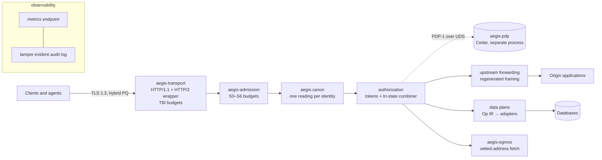

# AEGIS

A single-binary, post-quantum, formally specified reverse proxy and agent gateway for the middle tier of web and
API infrastructure, built so that its security properties hold for every request that passes through it.

> [!IMPORTANT]
> **Pre-release research software. Do not use in production.** Phases 0–2 of 7 have passed their gates; the
> agent-gateway phase is in progress. Interfaces may change only through recorded specification changes, and no
> release, signed artifact or support commitment exists yet. "AEGIS" is a working name.

## Overview

The middle tier (the reverse proxy, application server and API gateway between clients and data) is where most
request smuggling, path-confusion, tenant-isolation, server-side request forgery and resource-exhaustion failures
occur. AI agents increase both the number of automated clients and the speed at which vulnerabilities are found and
exploited.

AEGIS is designed as a **reference monitor** for that tier: one small mediation pipeline that every request and every
extension call must cross (admission → canonicalization → authorization → capability-scoped effect). Clients and
extensions interact with the server only through a fixed set of grammars — canonical request forms, a data-operation
language, capability tokens and extension interfaces — and properties are stated, proved or tested against those
grammars. A property established at the boundary therefore applies to every interaction that crosses it, including
applications and clients written by others.

The design and its evidence trail are in [`research/ARCHITECTURE.md`](research/ARCHITECTURE.md); the reasoning about
what this approach can and cannot guarantee is in [`SECURITY_BY_DESIGN.md`](SECURITY_BY_DESIGN.md).

## Distinguishing characteristics

| area | approach | evidence |
|---|---|---|
| Specification | Core invariants written in Lean 4; 117 frozen declarations, 64 machine-checked theorems; statements are hash-frozen so proof changes cannot alter what is proved | `spec/`, `ci/gate.sh` (6 independent proof checkers) |
| Verification wall | 20 independent oracles, each shown to fail on deliberately broken input before it is trusted as a gate | `oracles/`, `oracles/README.md` |
| Post-quantum TLS | TLS 1.3 only; hybrid ML-KEM key exchange preferred on public listeners and required on agent/API listeners; SecP384r1MLKEM1024 (RFC 10024) implemented and interoperability-tested | `tls/verdicts.toml`, `crates/aegis-tls` |
| Canonicalization | Exactly one parser per identity (path, host, query, headers, cookies, JSON); ambiguous inputs are rejected, not repaired | `crates/aegis-canon`, `oracles/canon-diff` |
| Tenant-safe data access | Data operations are expressed in an intermediate language whose lowering to SQL is proved to return exactly the permitted rows on exact backends | `spec/AegisIR/ThreeValued.lean`, `oracles/lowering-read`, `oracles/lowering-write` |
| Fail-closed authorization | Tri-state policy combination (error, timeout or crash ⇒ deny), Cedar evaluated in a separate process | `spec/AegisIR/Combine.lean`, `crates/aegis-pdp`, `oracles/pdp-dst` |
| Resource bounds | Per-connection and per-identity budgets enforced by a wrapper around the HTTP/2 stack and by an admission pipeline | `oracles/transport-limits`, `oracles/admission-props`, `ci/kani.sh` |
| Supply chain | Pinned toolchain, 7-day release cooldown, advisory and repository-advisory checks, cargo-vet ratchet, crate and `unsafe` budgets, byte-identical reproducible builds | `supply-chain/`, `ci/repro.sh`, `xtask/` |

## Architecture



Crates are layered (types → pure logic → protocol shells → effects → assembly) and the layering is enforced by
`cargo xtask layering`. All first-party crates are `#![forbid(unsafe_code)]` except one designated isolation crate.

## Status

| phase | scope | state |
|---|---|---|
| 0 | Repository, pins, frozen interfaces F1–F13, verification wall | GO (`gates/phase-0.verdict.json`) |
| 1 | 21 decision experiments; 10 design changes applied | closed (`spikes/APPLIED.md`) |
| 2 | Reverse-proxy mode: transport, TLS, canonicalization, admission, config, audit, metrics, ACME, zero-downtime upgrade | GO, 55/55 gate steps (`gates/phase-2.verdict.json`) |
| 3 | Agent gateway: capability tokens, Cedar decision process, SSRF-guarded egress, MCP listener gate | in progress (3 of 4 units complete) |
| 4–7 | Data plane and native handlers; process/Wasm isolation; compliance profiles and signed releases; deferred modules | planned |

Measured on the Phase-2 build (2026-10-26, x86_64 Linux): 4.96 MB stripped binary, 41 third-party crates shipped,
6.2 MB idle resident memory, systemd exposure score 1.6. Throughput figures are not published yet; laptop and LAN
measurements are provisional until repeated on a reference VPS.

## Getting started

Requirements: Linux x86_64 or aarch64, Rust 1.99.1 (selected automatically by `rust-toolchain.toml`), and `openssl`
for creating a test certificate. Building the verification wall additionally requires Python 3.12, Lean 4.35.0 and
Docker.

```sh
cargo build --release --locked -p aegis-bin
target/release/aegis                       # exits 78: no configuration means no listener (fail-closed boot)
target/release/aegis check-config config.json --print-effective
target/release/aegis --config config.json --cert tls.crt --key tls.key
```

A minimal configuration (schema: [`interfaces/F8-config.schema.json`](interfaces/F8-config.schema.json)):

```json
{"v": 1,
 "listeners": [{"name": "pub", "bind": "127.0.0.1:8443", "profile": "P-PUBLIC-WEB", "alpn": ["h2", "http/1.1"]}],
 "admin": {"bind": "127.0.0.1:9464"},
 "vhosts": [{"host": "example.test",
             "routes": [{"id": 1, "path": "/", "to": {"upstream": "127.0.0.1:8080"}, "authz": "allow-all"}]}]}
```

A route without an `authz` policy is denied. Running the full gate set for a phase:

```sh
python3 -I ci/run-gates.py --phase 2      # every gate plus its negative control; writes a hash-chained journal
```

## Security and assurance

Claims are stated by rung: **R4** machine-checked proof of a model, **R3** enforced by types or capabilities, **R2**
differential oracle, **R1** executed test harness. A proof covers its model, not the compiled code, unless a gate log
says otherwise. The complete, current list is [`SECURITY_CLAIMS.md`](SECURITY_CLAIMS.md); a summary:

| property | rung |
|---|---|
| Fail-closed policy combination | R4 + exhaustive test |
| Capability tokens only narrow under delegation; Rust verifier agrees with the Lean model | R4 model + R2 (10⁶ cases, 0 divergences) |
| Tenant-scoped data lowering returns exactly the permitted rows on exact backends | R4 model + R2 oracle |
| Writes never touch another tenant's rows (PostgreSQL, SQLite, MariaDB, CockroachDB with mandated forms) | R2 |
| One canonical reading per request identity | R2 (117,000+ cases, 0 disagreements) |
| Rate-limiter and token-bucket arithmetic | Kani proofs on the Rust implementation for stated bounds; remainder R1 |
| Stalled HTTP/2 streams reaped; per-connection memory bounded | R1, measured with h2load |
| Outbound requests never reach private or metadata addresses | R2 (273 cases, 0 violations) |

**Trusted, not verified.** hyper, h2, tokio, rustls, the AWS-LC C library and the Rust compiler are part of the
trusted computing base and are not verified by this project. Some AWS-LC components (the ML-KEM and ML-DSA assembly,
elliptic-curve arithmetic) are formally verified by their upstream maintainers; that verification is theirs, not ours.
The plan to reduce this trusted base is in [`SECURITY_BY_DESIGN.md`](SECURITY_BY_DESIGN.md) §5.

**FIPS 140-3.** AEGIS is not a validated cryptographic module and makes no FIPS validation claim. A planned build
profile is designed to use the AWS-LC FIPS 140-3 validated module (CMVP certificate #5314, the static
module; #5298 is the dynamic module and applies only to a dynamic build) on its
validated operating environments; that profile has not yet been built or tested.

**Not claimed:** microarchitectural (side-channel) isolation; the correctness of third-party extensions, adapters or
applications; the security of any path that bypasses AEGIS.

## Documentation

| document | purpose |
|---|---|
| [`SECURITY_CLAIMS.md`](SECURITY_CLAIMS.md) | What is claimed, at which rung, and what is trusted but unproven |
| [`SECURITY_BY_DESIGN.md`](SECURITY_BY_DESIGN.md) | How finite code and proof extend to unbounded use; responsibility boundary; trusted-base reduction plan |
| [`research/ARCHITECTURE.md`](research/ARCHITECTURE.md) | Reference architecture and decision record with evidence |
| [`research/templates/`](research/templates/) | Threat model, verification plan, invariants, supply chain, compliance map, benchmark plan |
| [`spec/SPEC_INVARIANTS.md`](spec/SPEC_INVARIANTS.md) | Frozen invariant statements (F1) |
| [`interfaces/`](interfaces/) | Frozen interfaces F1–F13 and their hash manifest |
| [`oracles/README.md`](oracles/README.md) | Contract every verification oracle follows |
| [`DEVIATIONS.md`](DEVIATIONS.md) | Where the implementation departs from the architecture, and why |
| [`spikes/APPLIED.md`](spikes/APPLIED.md) | Phase-1 experiments and the design decisions they changed |

## Reporting vulnerabilities

A vulnerability-reporting channel has not been set up yet and will be published before any public release. Do not
report vulnerabilities in public issues.

## Contributing

External contributions are not being accepted during pre-release. Development follows a role-separated workflow
(specification author, implementer, verifier) described in [`CLAUDE.md`](CLAUDE.md) and
[`research/templates/IMPLEMENTATION_PLAN.md`](research/templates/IMPLEMENTATION_PLAN.md): implementation work is
accepted only when its independent oracle passes and that oracle's negative control fails.

## Provenance

Builds are pinned to Rust 1.99.1 and a locked dependency graph and are byte-for-byte reproducible across build
directories (`ci/repro.sh`). Release signing (Ed25519, SLH-DSA-SHA2-128s, ML-DSA-87), SBOMs and build provenance are
planned for the release phase and do not exist yet.

## License

The workspace manifest declares Apache-2.0. A license file has not yet been added; until it is, no license is
granted. Third-party components remain under their own licenses (see `Cargo.lock` and `deny.toml`).

## Notices

**Export control.** This repository contains publicly available source code implementing standard cryptographic
algorithms (including ML-KEM, ML-DSA, ECDH and AES-GCM) through third-party libraries. Recipients are responsible for
compliance with applicable export-control laws and regulations.

**No endorsement.** References to products, standards bodies, agencies and companies are for identification only and
do not imply endorsement by, or of, any of them.
